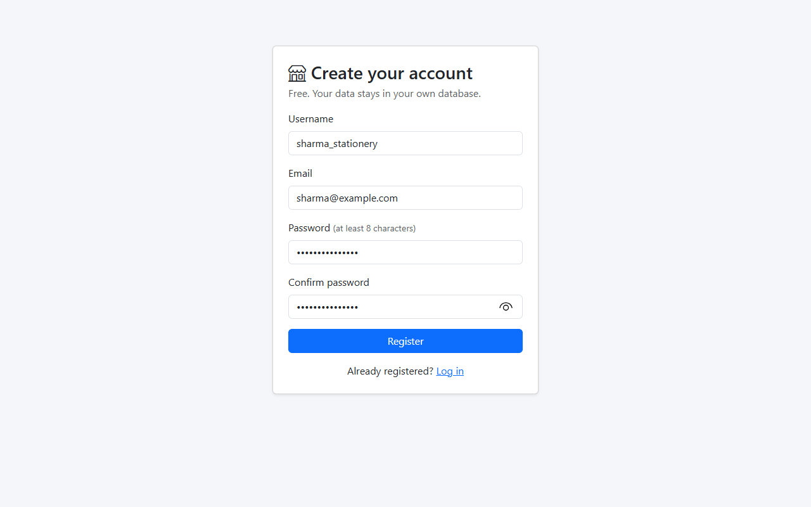
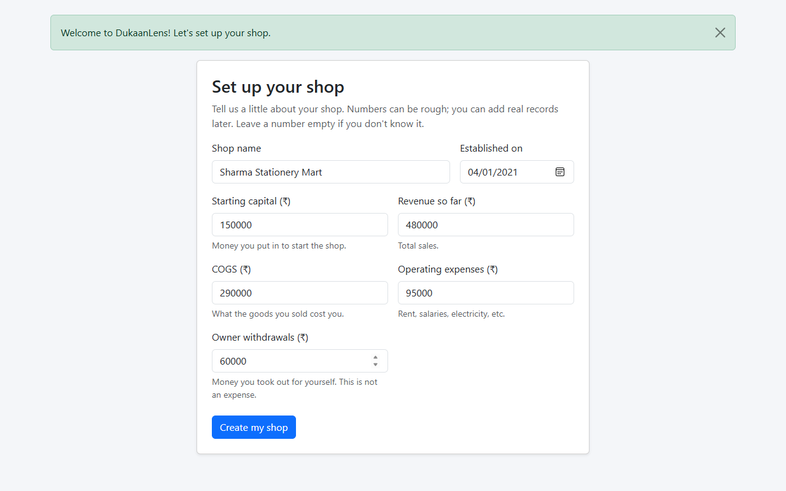
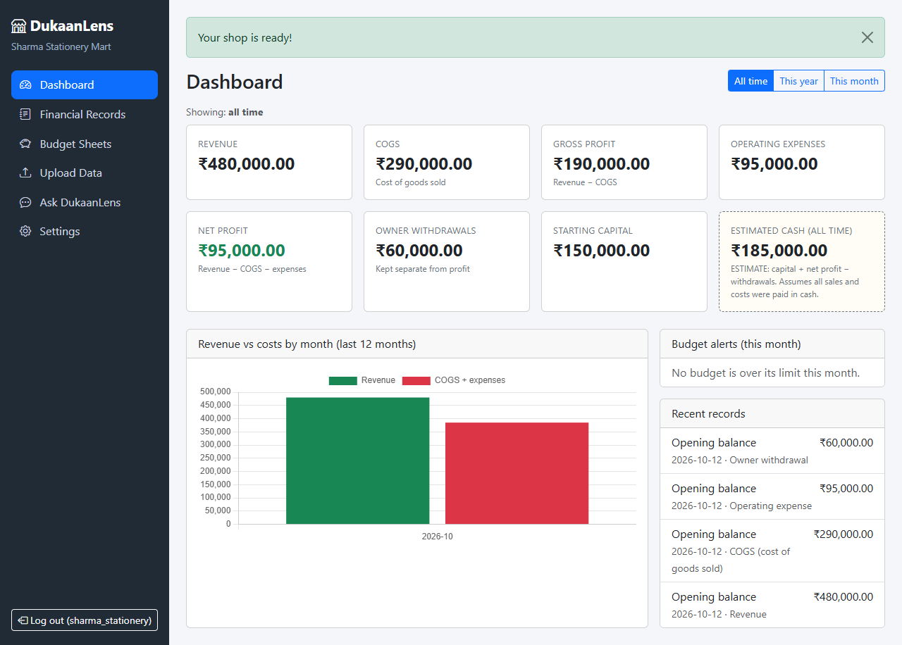
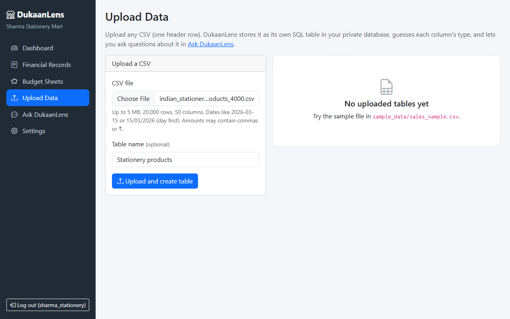
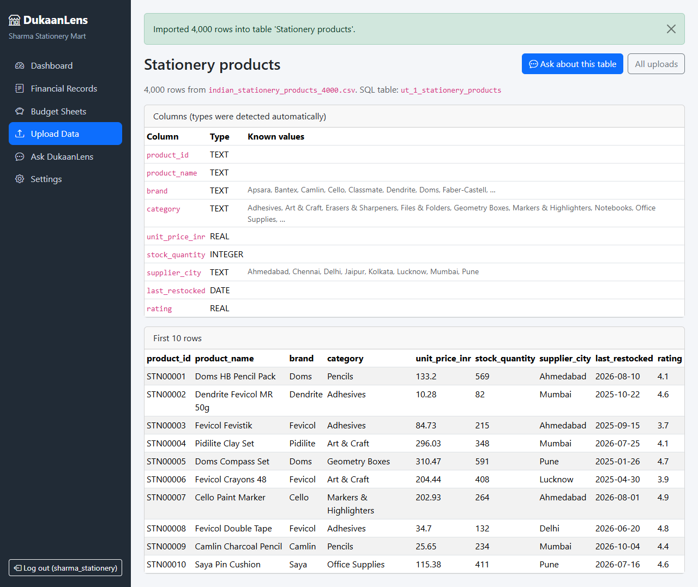
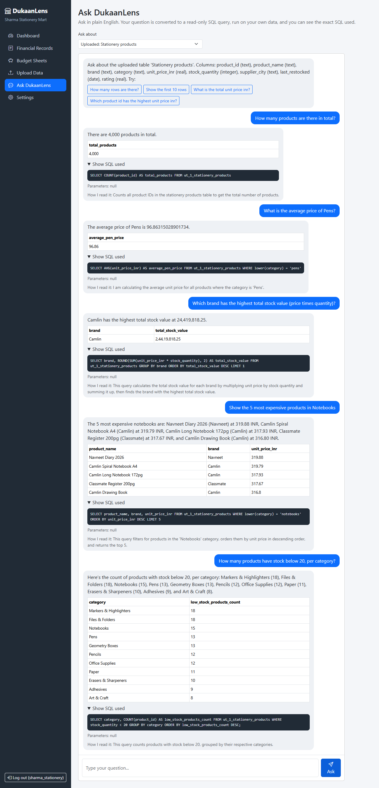

# DukaanLens

A finance dashboard for small shop owners. Track revenue, costs and budgets,
upload your own CSV files, and ask questions about your data in plain English.

**Stack:** Python, Flask, SQLite, SQLAlchemy, Flask-Login, Bootstrap, vanilla JavaScript,
Google Gemini (each user brings their own free API key). One repository, one process, no Docker.

## Features

- **Accounts:** register, log in, log out, hashed passwords, strict per-user data isolation.
- **Shop setup:** shop name, establishment date, starting capital, revenue, COGS, operating
  expenses and owner withdrawals.
- **Dashboard:** revenue, COGS, gross profit, expenses, net profit, owner withdrawals and a clearly
  labelled *estimated* cash figure. Monthly chart and budget alerts.
- **Financial records:** add, edit, delete, filter and export CSV.
- **Budget sheets:** a monthly limit per category with spent / remaining / over-limit status.
- **Upload Data:** upload any CSV. It becomes a real SQLite table with detected column types
  (integer, decimal, date, text).
- **Ask DukaanLens (AI):** type a question; Gemini writes a SQL query; the app runs it in a
  read-only sandbox and Gemini phrases the answer. You see the SQL and the result rows.

## Setup

```bash
git clone https://github.com/faizdevx/DukaanLens.git
cd DukaanLens
python -m venv venv
# Windows:  venv\Scripts\activate        macOS/Linux:  source venv/bin/activate
pip install -r requirements.txt
cp .env.example .env        # then put a real SECRET_KEY inside
python run.py               # open http://127.0.0.1:5000
```

Then: **Settings → Gemini API key**. Get a free key from <https://aistudio.google.com/apikey>.
The key is verified with a tiny test request, then stored encrypted.

Optional demo data (user `demo`, password `demo12345`):

```bash
flask --app run seed-demo
```

A sample CSV to try uploading is in `sample_data/sales_sample.csv`.

Run the tests (Gemini is faked in the tests, no key or network needed):

```bash
python -m pytest
```

## Example walkthrough

A shop owner signs up, describes the shop, uploads a product CSV and asks questions in plain
English. The data is a generated sample of 4,000 Indian stationery products
(`sample_data/indian_stationery_products_4000.csv`: `product_id, product_name, brand, category,
unit_price_inr, stock_quantity, supplier_city, last_restocked, rating`).

### 1. Sign up



### 2. Describe the shop (first login)

Example details used: shop name *Sharma Stationery Mart*, established 2021-04-01, starting
capital ₹1,50,000, revenue ₹4,80,000, COGS ₹2,90,000, operating expenses ₹95,000, owner
withdrawals ₹60,000.



### 3. Dashboard

Gross profit = 480,000 − 290,000 = ₹1,90,000. Net profit = 190,000 − 95,000 = ₹95,000.
Withdrawals stay separate. Estimated cash is labelled as an estimate.



### 4. Upload the CSV (the main feature)

Open **Upload Data**, choose the file, optionally name the table, click upload.



DukaanLens creates a real SQLite table (`ut_<your id>_stationery_products`) and detects each
column's type. Here `unit_price_inr` and `rating` are REAL, `stock_quantity` is INTEGER and
`last_restocked` is a DATE.



### 5. Ask in plain English

In **Ask DukaanLens** pick *Uploaded: Stationery products* and type a question. Gemini writes the
SQL, the sandbox runs it, and you see the answer, the result rows and the exact SQL.



Real answers from this run (model `gemini-2.5-flash`). The last column is an independent check
computed with plain Python straight from the CSV:

| Question | SQL written by Gemini | Answer | Independent check |
| --- | --- | --- | --- |
| How many products are there in total? | `SELECT COUNT(product_id) AS total_products FROM ut_1_stationery_products` | 4,000 | 4,000 ✔ |
| What is the average price of Pens? | `SELECT AVG(unit_price_inr) AS average_pen_price ... WHERE lower(category) = 'pens'` | 96.863… (≈ ₹96.86; the table cell shows 96.86) | 96.86 ✔ |
| Which brand has the highest total stock value (price times quantity)? | `SELECT brand, ROUND(SUM(unit_price_inr * stock_quantity), 2) ... GROUP BY brand ORDER BY ... DESC LIMIT 1` | Camlin, 24,419,818.25 | Camlin, 24,419,818.25 ✔ |
| Show the 5 most expensive products in Notebooks | `SELECT product_name, brand, unit_price_inr ... WHERE lower(category) = 'notebooks' ORDER BY unit_price_inr DESC LIMIT 5` | Navneet Diary 2026 (319.88), Camlin Spiral Notebook A4 (319.79), Camlin Long Notebook 172pg (317.93), Classmate Register 200pg (317.67), Camlin Drawing Book (316.80) | same 5 ✔ |
| How many products have stock below 20, per category? | `SELECT category, COUNT(product_id) ... WHERE stock_quantity < 20 GROUP BY category ORDER BY ... DESC` | Markers & Highlighters 18, Files & Folders 18, Notebooks 15, Pens 13, Geometry Boxes 13, Pencils 12, Office Supplies 12, Paper 11, Erasers & Sharpeners 10, Adhesives 9, Art & Craft 8 | same counts ✔ |

The full raw output (question, SQL, rows) is in [`docs/example_run.json`](docs/example_run.json).
To regenerate the screenshots and this run yourself:
`pip install playwright`, set `GEMINI_API_KEY`, then `python scripts/make_screenshots.py`
(uses your installed Microsoft Edge; the free Gemini tier is rate-limited, so it paces itself).

> Only 5 questions were run, so this shows the idea works, not that Gemini is always right.
> Always glance at the SQL for numbers you rely on.

## How Ask DukaanLens works

1. The app tells Gemini which tables you may query (names, types, a few example values).
   For **My shop records** these are temporary copies of *your* rows only
   (`shop_records`, `shop_budgets`, `shop_info`). For uploads it is the one uploaded table.
2. Gemini returns one SQLite `SELECT` as JSON, or a clarifying question.
3. `sandbox.py` runs it:
   - single statement, must start with `SELECT`/`WITH`, no comments or write keywords;
   - a SQLite **authorizer** lets SQLite itself refuse every table except the allowed ones and
     every function except a short allowlist;
   - 3-second time limit and 200-row cap.
4. If SQLite reports an error, Gemini gets the error once to correct the query.
5. Gemini writes a one-or-two-sentence answer from the real result rows.

### Privacy: what is sent to Google

Your question, the table/column names and types, a few example values per text column, the
generated SQL, and up to 30 result rows (for the final sentence). Nothing else. Your API key is
sent only as the `x-goog-api-key` header.

### Honest limits

- Gemini is not perfect: it can misread a question or write the wrong query. That is why the SQL
  and a one-line "how I read it" are always shown. Check them for important numbers.
- The sandbox guarantees *safety* (read-only, only your data), not *correctness*.
- Without an API key, Ask DukaanLens does not answer: there is no offline fallback.
- Quota, rate limits and costs are those of your own Gemini key.

## Numbers

| Metric | Formula |
| --- | --- |
| Gross profit | Revenue − COGS |
| Net profit | Revenue − COGS − Operating expenses |
| Owner withdrawals | Tracked separately. **Not** an expense, never reduces profit |
| Estimated cash | Starting capital + Net profit − Owner withdrawals |

Estimated cash is only a guess: it assumes every sale was paid in cash and every cost was paid
immediately. Opening figures from shop setup are saved as ordinary records in category
*Opening balance*.

## CSV upload rules

- UTF-8 or Latin-1; delimiter `,` `;` tab or `|` detected automatically; first row is the header.
- Up to 5 MB, 20,000 rows, 50 columns, 10 tables per user.
- Headers become safe names (`Unit Price (Rs)` → `unit_price_rs`).
- Types: integers and decimals (commas, `₹`, `$`, `Rs.` allowed), dates (`2026-03-15`,
  `15/03/2026` read as **day first**), otherwise text. IDs/phones with leading zeros stay text.
- Empty cells become NULL.

## Security notes

- Passwords hashed (Werkzeug); API keys encrypted with Fernet using a key derived from
  `SECRET_KEY` (so `SECRET_KEY` must be set to save a key, and must not change).
- CSRF token on every POST; input validation; CSV export neutralises spreadsheet formulas.
- Uploaded table names are `ut_<user id>_<name>` made of `[a-z0-9_]` only; rows are inserted with
  bound parameters; AI-generated SQL never touches other users' data or app tables.
- Treat the Gemini key like a password: use a key with a quota limit.

## Project layout

```
run.py                    start the app
dukaanlens/
  __init__.py             app factory, CSRF, config
  models.py               User, Shop, FinancialRecord, Budget, UploadedTable, ApiKey
  auth.py main.py records.py budgets.py uploads.py chat.py   routes (blueprints)
  ai_sql.py               Gemini prompts, schema building, answer pipeline
  sandbox.py              read-only SQL sandbox (authorizer, limits)
  csv_import.py           CSV -> typed SQLite table
  apikeys.py              encrypted Gemini key storage
  finance.py queries.py   dashboard calculations and fixed queries
  seed.py                 demo data
  templates/ static/      Bootstrap UI, CSS, JS
tests/                    pytest: auth, isolation, finance, uploads, AI pipeline (faked Gemini)
```

Amounts are stored as floats (fine for learning; use `Decimal`/integer paise for real accounting).
